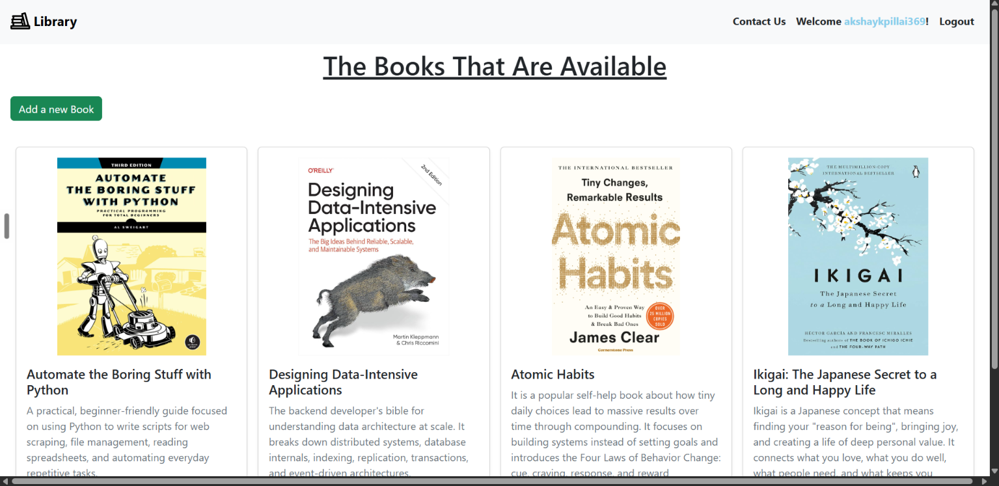
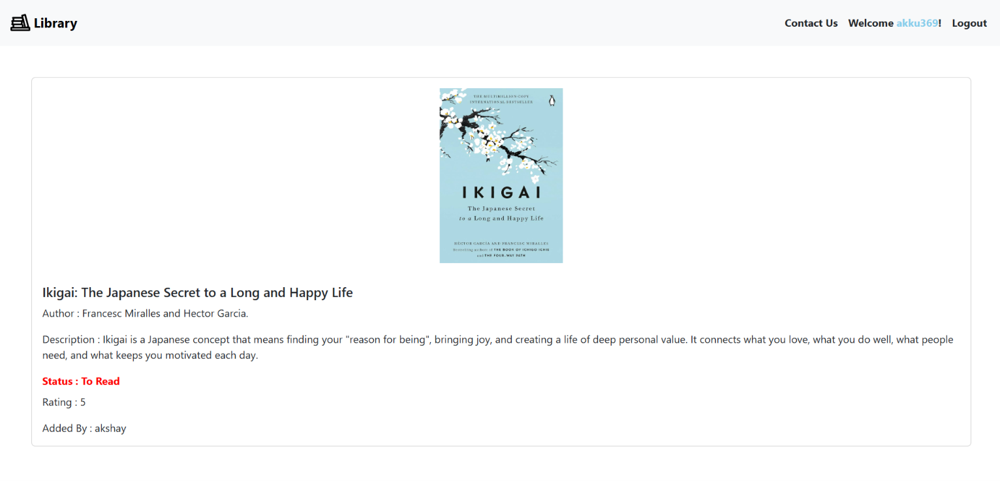
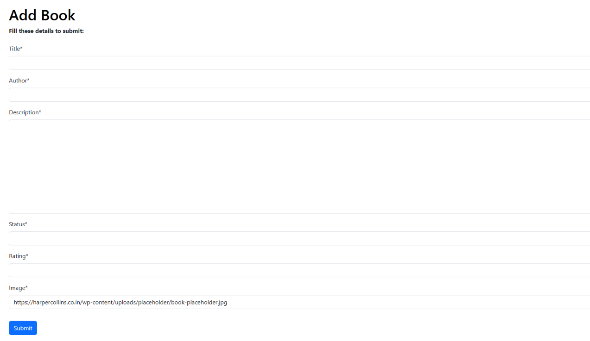

# Library

This is a library management system built in Django

# Description

This is my first project I did when I am learning Django. Before Django, I learned web development, and from that bootstarp become my favorite, so I used bootstrap also in this project

# Why I made this

I made this as a part of learning Django

# Outcomes from learning this

I able to understand django much more and learned about templates , pillow, authentication, permission and many more. 

# Features
- Add a book
- Edit a book(editable only by the user who added it)
- Delete a book(deletable only by the user who added it)
- Can see all uploaded books and its status(To read, In progress, Completed)

# Screenshots

# To make this project yours
- git clone this project
- go to the project folder
- then in terminal , run pip install -r requirements.txt
- next, run python manage.py migrate
- then in terminal, run python manage.py runsever

That's all hosted this project locally! Open http://127.0.0.1:8000/ in your browser and you can see the project is running

# Credits

Readme Demo by @FaizeenHoque, given to me by Hackclub pixl team

